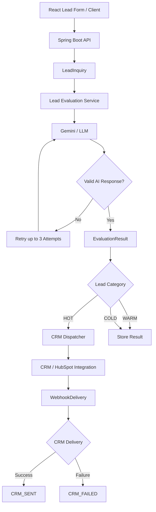

# AI Lead Qualification & CRM Automation Platform

> An AI-powered lead automation system that receives incoming leads, evaluates and qualifies them using an LLM, validates and retries AI decisions, stores the evaluation history, and automatically routes qualified leads to a CRM.

## 🚀 Overview

Businesses receive leads from websites, forms, advertising platforms, social media, and other sources. Manually reviewing, qualifying, routing, and updating every lead in a CRM is repetitive, slow, and error-prone.

This project automates that workflow.

The current system follows:

```text
Lead
  ↓
Lead Ingestion
  ↓
AI Evaluation
  ↓
Score + Category + Confidence
  ↓
Validation
  ↓
Retry on AI Failure (max 3 attempts)
  ↓
Persist Evaluation History
  ↓
HOT / WARM / COLD
  ↓
HOT Lead?
  ├── NO → Complete
  │
  └── YES
        ↓
     CRM Integration
        ↓
   Delivery Tracking
```

The long-term goal is to evolve this into an enterprise-oriented **AI CRM automation platform** capable of handling multiple lead sources, sales workflows, communication channels, CRM integrations, and organization-level automation.

---

# 🎯 Problem Being Solved

Sales teams often spend significant time on repetitive work:

* Reviewing incoming leads
* Determining lead quality
* Prioritizing sales opportunities
* Updating CRM records
* Assigning leads
* Creating follow-up tasks
* Sending repetitive messages
* Tracking failed integrations

This project moves those repetitive decisions and actions into an automated backend workflow.

### Traditional workflow

```text
Lead
 ↓
Salesperson manually reads lead
 ↓
Manual qualification
 ↓
Manual CRM entry
 ↓
Manual follow-up
```

### Automated workflow

```text
Lead
 ↓
AI qualification
 ↓
Business decision
 ↓
Automatic CRM action
 ↓
Delivery tracking
```

---

# 🏗️ Current Architecture



---

# ✅ Version 1 — AI Lead Qualification & CRM Automation

## Current Version 1 Goal

Build a reliable end-to-end pipeline:

```text
Lead → AI → Qualification → CRM
```

### Implemented Core Features

* Lead ingestion through a REST API
* React-based lead submission/dashboard
* Lead persistence using JPA
* AI-powered lead evaluation
* HOT / WARM / COLD classification
* AI confidence/uncertainty signal
* AI reasoning
* Recommended action
* Structured AI response
* AI response validation
* Maximum 3 AI evaluation attempts
* Separate database record for each evaluation attempt
* Single permanent ID for each lead
* AI failure classification
* `AI_SUCCESS` / `AI_FAILURE` processing states
* CRM webhook delivery layer
* Maximum 3 CRM delivery attempts
* CRM delivery status tracking
* CRM failure handling
* Webhook delivery persistence
* Lead status updates such as `CRM_SENT` and `CRM_FAILED`

## AI Retry Design

A single lead always keeps the same lead ID.

Example:

```text
Lead ID: 101

Attempt 1 → TIMEOUT
Attempt 2 → INVALID_RESPONSE
Attempt 3 → SUCCESS
```

Database history:

```text
Evaluation 1 → FAILED
Evaluation 2 → FAILED
Evaluation 3 → SUCCESS
```

Only the successful evaluation becomes the final business result.

When all three attempts fail:

```text
Lead 101
    ↓
AI_FAILURE
```

This preserves an auditable attempt history without creating duplicate leads.

---

# 🤖 AI Evaluation

The AI evaluates information associated with the lead and returns a structured business result.

Example:

```json
{
  "score": 87,
  "category": "HOT",
  "confidence": 0.91,
  "reasoning": "Strong purchase intent and relevant company profile.",
  "recommendedAction": "SEND_TO_CRM"
}
```

### AI validation

The application validates:

```text
Score range
Required fields
Category
Reasoning
Recommended action
Business-rule consistency
```

The backend remains responsible for enforcing the final business decision.

> AI recommends. The application validates and executes.

---

# 🔄 Failure Handling

The system distinguishes between different failure classes.

### AI failures

```text
TIMEOUT
NETWORK_ERROR
API_ERROR
RATE_LIMITED
SERVICE_UNAVAILABLE
EMPTY_RESPONSE
INVALID_RESPONSE
PARSING_ERROR
MISSING_REQUIRED_FIELD
VALIDATION_ERROR
AUTHENTICATION_ERROR
QUOTA_EXCEEDED
BUSINESS_RULE_VIOLATION
```

Retryable failures can be retried up to three times.

Non-retryable configuration or authentication failures can stop processing without wasting additional attempts.

---

# 🔗 CRM Automation

After successful AI qualification:

```text
Category = HOT
        ↓
CRM Dispatcher
        ↓
CRM API / Webhook
        ↓
Delivery Tracking
```

CRM delivery attempts are independently tracked from AI evaluation attempts.

Example:

```text
AI
 ↓
HOT
 ↓
CRM Attempt 1 → 500
CRM Attempt 2 → 503
CRM Attempt 3 → 200
 ↓
CRM_SENT
```

This separation prevents a CRM delivery failure from triggering unnecessary AI re-evaluation.

### CRM delivery history

```text
WebhookDelivery

id
leadId
eventId
attemptNumber
status
responseCode
responseBody
errorMessage
createdAt
lastAttemptAt
```

---

# 🖥️ React Dashboard

The frontend provides a basic interface for submitting and monitoring leads.

The dashboard is designed around the lead lifecycle rather than simply displaying raw database records.

Example states:

```text
READY
SUBMITTING
PROCESSING
AI_SUCCESS
AI_FAILURE
CRM_SENT
CRM_FAILED
```

Example dashboard information:

```text
Total Leads
HOT Leads
WARM Leads
COLD Leads
AI Failures
CRM Sent
CRM Failures
```

Lead details can display:

```text
Company
Email
Message

AI Score
Category
Confidence
Reasoning
Recommended Action

AI Processing Status
CRM Delivery Status
```

---

# 🗄️ Data Model

### LeadInquiry

Represents one unique lead.

```text
id
companyName
contactEmail
message
submittedAt
processingStatus
```

### EvaluationResult

Stores AI evaluation attempts.

```text
id
leadId
attemptNumber
score
category
confidence
reasoning
recommendedAction
status
failureType
failureMessage
```

### WebhookDelivery

Stores CRM delivery attempts.

```text
id
leadId
eventId
attemptNumber
status
responseCode
responseBody
errorMessage
createdAt
lastAttemptAt
```

Relationship:

```text
LeadInquiry
   │
   ├── EvaluationResult 1
   ├── EvaluationResult 2
   └── EvaluationResult 3

LeadInquiry
   │
   ├── WebhookDelivery 1
   ├── WebhookDelivery 2
   └── WebhookDelivery 3
```

---

# 🧰 Technology Stack

### Backend

* Java
* Spring Boot
* Spring AI
* Google Gemini / Google GenAI
* Spring Data JPA
* Hibernate
* REST APIs

### Frontend

* React
* JavaScript
* REST API integration

### Database

* H2 for the current development environment
* JPA/Hibernate persistence

### Integration

* REST APIs
* Webhooks
* CRM integration layer

### Development

* Maven
* Git
* GitHub
* IntelliJ IDEA

---

# 📈 Version Roadmap

## Version 1 — AI Qualification + CRM Automation

**Status: Launch Version**

```text
✓ Lead ingestion
✓ AI qualification
✓ Lead scoring
✓ HOT/WARM/COLD classification
✓ Confidence
✓ AI reasoning
✓ AI response validation
✓ AI retry mechanism
✓ Evaluation history
✓ AI failure handling
✓ CRM delivery layer
✓ CRM retry mechanism
✓ CRM delivery history
✓ Lead processing states
✓ React dashboard
○ Finalize and verify the selected CRM connector
○ End-to-end production-style testing
```

### Main achievement

> **An end-to-end AI lead qualification pipeline that can make a structured decision and automatically trigger CRM operations.**

---

# Version 2 — Multi-Source Lead & Sales Workflow Automation

**Status: Planned**

The goal of V2 is to move from one lead-entry path to a real lead lifecycle automation system.

```text
Website
   +
WordPress
   +
Meta / Facebook / Instagram
   +
LinkedIn
   +
Other Webhooks
        ↓
Unified Lead Ingestion
        ↓
Normalization
        ↓
Deduplication
        ↓
AI Qualification
        ↓
Sales Pipeline
        ↓
Assignment
        ↓
Follow-up
        ↓
CRM
```

### Planned V2 capabilities

* Multi-source lead ingestion
* Source tracking
* Campaign tracking
* UTM tracking
* Lead normalization
* Duplicate lead detection
* Sales pipeline stages
* Lead ownership
* Automatic salesperson assignment
* Automatic task creation
* Follow-up reminders
* Email automation
* Lead segmentation
* Lead nurturing
* Re-engagement workflows
* WhatsApp integration
* Sales activity tracking
* Conversion reporting
* Improved React dashboard

### Main achievement

> **Automate the complete lead lifecycle from acquisition to follow-up.**

---

# Version 3 — Enterprise AI Automation Platform

**Status: Planned**

V3 focuses on scalability, extensibility, security, and multiple organizations.

### Planned architecture

```text
                    React Dashboard
                           ↓
                      API Layer
                           ↓
                  Automation Platform
                           ↓
                ┌──────────┴──────────┐
                ↓                     ↓
         Workflow Engine         AI Engine
                ↓                     ↓
              Kafka                 RAG
                ↓                     ↓
         Event Processing       AI Decisions
                └──────────┬──────────┘
                           ↓
                    Integration Layer
                           ↓
          ┌────────────────┼────────────────┐
          ↓                ↓                ↓
       HubSpot           Zoho          Salesforce
                           ↓
                     External Tools
```

### Planned V3 capabilities

* Event-driven architecture
* Kafka
* Redis
* Workflow engine
* Multi-CRM integrations
* Tool-based AI agents
* Human-in-the-loop approval
* Role-based access control
* Multi-tenancy
* Tenant-level CRM configuration
* Audit logs
* Idempotency
* Rate limiting
* Distributed tracing
* Metrics and observability
* Cloud deployment
* CI/CD
* Advanced security
* Scalable background processing

### Main achievement

> **Evolve the application from a lead automation project into a configurable enterprise AI automation platform.**

---

# 📊 Business Impact

The system is designed to reduce repetitive sales operations.

### Without automation

```text
Lead
 ↓
Manual review
 ↓
Manual qualification
 ↓
Manual CRM update
 ↓
Manual follow-up
```

### With automation

```text
Lead
 ↓
AI qualification
 ↓
Automatic decision
 ↓
CRM update
 ↓
Follow-up workflow
```

Potential operational benefits include:

* Faster lead qualification
* Reduced manual CRM data entry
* Faster routing of high-value leads
* More consistent qualification
* Better visibility into lead status
* Reliable tracking of integration failures
* Reduced repetitive sales operations

---

# 🔐 Reliability Principles

The application is designed around several reliability concepts:

### One lead = one permanent identity

A retry never creates another lead.

### AI retries are separate from CRM retries

An AI failure does not cause unnecessary CRM operations, and a CRM failure does not trigger another AI evaluation.

### Persistent attempt history

Failed attempts are stored rather than silently discarded.

### Structured AI output

Business logic operates on validated fields rather than free-form model text.

### Explicit processing states

Every lead can move through recognizable processing states.

### Idempotent CRM delivery

The system is designed to prevent duplicate external actions as the integration layer evolves.

---

# 🧪 Testing Strategy

The application should be tested against realistic success and failure scenarios:

```text
✓ HOT lead
✓ WARM lead
✓ COLD lead

✓ AI succeeds on attempt 1
✓ AI fails then succeeds
✓ AI fails all 3 attempts

✓ CRM succeeds
✓ CRM temporarily fails then succeeds
✓ CRM fails after maximum attempts

✓ Duplicate delivery protection
✓ Invalid input
✓ Invalid AI response
✓ Network failure
```

---

# 🔌 API Example

### Create Lead

```http
POST /api/leads
Content-Type: application/json
```

Example:

```json
{
  "companyName": "ABC Technologies",
  "contactEmail": "rahul@example.com",
  "message": "We are looking for an AI automation solution for our sales process."
}
```

### Example outcome

```json
{
  "leadId": 101,
  "score": 87,
  "category": "HOT",
  "confidence": 0.91,
  "status": "CRM_SENT"
}
```

---

# 📂 Project Structure

```text
ai-lead-qualification-agent/
│
├── src/
│   ├── main/
│   │   ├── java/
│   │   │   └── com/myapp/aileadqualificationagent/
│   │   │       ├── controller/
│   │   │       ├── service/
│   │   │       ├── repository/
│   │   │       ├── model/
│   │   │       └── dto/
│   │   │
│   │   └── resources/
│   │
│   └── test/
│
├── frontend/
│
├── docs/
│   ├── architecture/
│   ├── api/
│   └── database/
│
├── .gitignore
├── pom.xml
└── README.md
```

---

# 🚀 Running the Application

## Backend

```bash
mvn spring-boot:run
```

## Frontend

```bash
npm install
npm run dev
```

## Environment Variables

Do not commit secrets to GitHub.

Example:

```text
GEMINI_API_KEY=your_key
CRM_API_TOKEN=your_token
CRM_API_URL=your_url
```

---

# 🔒 Security

Sensitive credentials are kept outside source control through environment-based configuration.

Never commit:

```text
API keys
CRM tokens
OAuth secrets
.env files
production credentials
```

---

# 🗺️ Development Philosophy

This project is intentionally being developed in stages.

```text
V1
AI Decision + CRM Action
        ↓
V2
Complete Lead Lifecycle Automation
        ↓
V3
Enterprise Automation Platform
```

Each version is designed to add a meaningful engineering and business capability rather than simply adding more technologies.

---

# 👨‍💻 Project Focus

This project combines:

```text
AI
+
Backend Engineering
+
Database Design
+
API Integration
+
CRM Automation
+
Reliability Engineering
+
Frontend Monitoring
```

The objective is to demonstrate the ability to build software that does not merely generate AI output, but **uses AI as part of a reliable business workflow**.

---

# 📌 Current Development Status

### Version 1

**Launch preparation**

Core AI qualification, persistence, retry handling, CRM delivery architecture, and React interface are being completed and tested.

### Version 2

**Planned**

Multi-source lead ingestion, sales pipeline automation, ownership, follow-ups, communication automation, and reporting.

### Version 3

**Planned**

Event-driven, multi-CRM, multi-tenant enterprise automation platform with security, observability, workflow orchestration, and scalable processing.

---

# 📸 Demo

Add screenshots here:

```text
1. React lead submission
2. AI evaluation result
3. Lead dashboard
4. AI attempt history
5. CRM delivery status
6. CRM contact created
```

When a public demo becomes available:

```text
Live Demo: <URL>
API Documentation: <URL>
```

---

# 📈 Future Direction

The final product vision is:

```text
Multiple Lead Sources
        ↓
Unified Lead Ingestion
        ↓
AI Lead Intelligence
        ↓
Qualification
        ↓
Decision Engine
        ↓
Workflow Automation
        ↓
CRM + Communication Tools
        ↓
Analytics
        ↓
Outcome Feedback
        ↓
Continuous Improvement
```

> **From AI lead scoring to intelligent end-to-end sales automation.**
